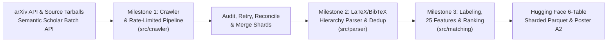

# arXiv Harvester

[](https://www.python.org/downloads/)
[](https://github.com/NguyenQuocDat06-AI/arxiv-harvester/actions/workflows/ci.yml)
[](https://nguyenquocdat06-ai.github.io/arxiv-harvester-book/)
[-yellow?logo=huggingface&logoColor=black)](https://huggingface.co/datasets/nquocdat06/arxiv-harvester-data)

Hệ thống thu thập đa phiên bản bài báo arXiv, phân tích cấu trúc LaTeX/BibTeX phân cấp có khử trùng và khớp tài liệu tham khảo bằng học máy cổ điển (Milestone 1 → Milestone 3), xuất bản thành bộ dữ liệu **6 bảng Parquet phân mảnh chuẩn Hugging Face** trên quy mô **25.000 bài báo**.

---

## Tổng quan & Kết quả đạt được

Dự án triển khai trọn vẹn pipeline dữ liệu học thuật qua ba giai đoạn tích lũy trên cùng một kho mã nguồn:

1. **Milestone 1 — Thu thập đa phiên bản & trích dẫn (`src/crawler/`)**: Khám phá toàn bộ dải arXiv ID được giao của 5 thành viên, truy xuất đầy đủ mọi phiên bản (`v1..vN`), tải và lọc sạch mã nguồn `.tex`/`.bib` (giữ `.bbl` bổ trợ, loại ảnh nhị phân khi giải nén) cùng metadata trích dẫn từ Semantic Scholar API có lưu nguồn gốc (*provenance*).
2. **Milestone 2 — Phân tích cấu trúc phân cấp & khử trùng (`src/parser/`)**: Tự động xác định compilation root và đường dẫn `\input`/`\include`, dựng cây phân cấp theo từng phiên bản (`document → section → ... → sentence / math / figure / list`), chuẩn hóa LaTeX & công thức toán, chuyển `\bibitem` sang BibTeX, khử trùng 2 tầng xuyên phiên bản (hợp nhất trường + đổi tên `\cite{}`) và kiểm chuẩn toàn vẹn 5 bảng bằng SQLite ngoài bộ nhớ.
3. **Milestone 3 — Khớp tài liệu tham khảo (`src/matching/`)**: Xây dựng tập nhãn chuẩn (Manual + Automatic) theo quy tắc từng thành viên, trích xuất **25 đặc trưng cổ điển** (kết hợp **4 đặc trưng ngữ cảnh cây phân cấp M2**, không dùng LLM hay mô hình pretrained), huấn luyện so sánh 4 mô hình xếp hạng/phân loại cổ điển, đánh giá theo **MRR@5** và đóng gói trọn bộ **6 bảng Parquet** lên Hugging Face.

### Bảng tổng hợp kết quả thực nghiệm (25.000 bài báo — Google Colab CPU-only)

| Giai đoạn | Chỉ tiêu | Kết quả xác minh | Ghi chú |
|---|---|---:|---|
| **M1** | Số bài báo / phiên bản | `25.000` / `41.498` | `38.554` TeX xác minh, `2.764` PDF-only/rỗng, `169` HTTP 404 (`0` trùng chéo thành viên) |
| **M1** | Trích dẫn (Working / Course) | `976.351` / `456.149` | `0` trích dẫn mồ côi; bảng `references` chuẩn giữ các trích dẫn có `ref_arxiv_id` |
| **M2** | Độ phủ parse & cấu trúc | `85,66%` success / `97,34%` parsed | `33.025` thành công + `4.503` bán phần trên TeX; `structural_valid = True`, `0` thiếu version |
| **M2** | Khử trùng 2 tầng | Elements `-35,04%` / BibTeX `-35,83%` | Elements `23,10M → 15,01M`; BibTeX `1,83M → 1,18M`; Hierarchy `22,53M` cạnh |
| **M2** | Hiệu năng Colab CPU-only | `18.692,09s` (`0,7477s/bài`) | 5 phiên độc lập (`reused = 0`); Peak RSS `845,34 MiB`, TB trọng số `240,00 MiB` |
| **M3** | Quy mô gán nhãn (`k = 5`) | `3.022` bài / `162.469` mục | `25` bài Manual (`1.150` mục) + `2.997` bài Auto (`12,0%` > ngưỡng `10%`, `161.319` mục) |
| **M3** | Kết quả Test **MRR@5** | **`0,6907`** *(Test-Manual `0,8885`)* | `LightGBM Ranker`: `100,0%` Recall@1 & Recall@5 trên toàn bộ `373` mục có đích arXiv |
| **HF** | Bộ dữ liệu 6 bảng Parquet | `38` shards / `3,92 GiB` | Đã xuất bản công khai tại [nquocdat06/arxiv-harvester-data](https://huggingface.co/datasets/nquocdat06/arxiv-harvester-data) (`valid = True`) |

- **Báo cáo phân tích M1–M2 (Jupyter Book):** [nguyenquocdat06-ai.github.io/arxiv-harvester-book](https://nguyenquocdat06-ai.github.io/arxiv-harvester-book/)
- **Bộ dữ liệu công khai 6 bảng (Hugging Face):** [huggingface.co/datasets/nquocdat06/arxiv-harvester-data](https://huggingface.co/datasets/nquocdat06/arxiv-harvester-data)

---

## Kiến trúc hệ thống



---

## Cấu trúc mã nguồn

```text
arxiv-harvester/
├── .github/workflows/ci.yml        # CI kiểm tra cú pháp, notebook JSON, cài đặt & CLI
├── configs/
│   └── parser_roots.json           # Cấu hình override compilation root đã kiểm chứng
├── data/                           # Khung thư mục dữ liệu cục bộ (không commit dữ liệu thô)
├── docs/                           # 9 notebook phân tích kỹ thuật M1, M2 & M3 (01–09)
├── src/
│   ├── requirements.txt            # Ánh xạ danh sách phụ thuộc theo chuẩn sơ đồ đề bài
│   ├── crawler/                    # Milestone 1: discovery, downloader, S2 batch, profiler, merge
│   ├── parser/                     # Milestone 2: TeX gather/lexer, hierarchy, bibtex, dedup, validation
│   └── matching/                   # Milestone 3: cleaning, labeling, 25 features, ranking, EDA & stress-test
├── tools/
│   ├── build_report.py             # Dựng Jupyter Book từ dữ liệu M1/M2 cục bộ
│   ├── build_team_25000_book.py    # Dựng Jupyter Book 25.000 bài hoàn chỉnh
│   ├── extract_book_aggregates_colab.py
│   ├── m1_colab_tri_resume.py      # Resume M1 cho 24120470 trên Colab CPU
│   ├── m2_colab_runner.py          # Điều phối parse M2 trên Colab CPU
│   ├── m2_team_consolidator.py     # Gộp & kiểm chuẩn 5 thành viên (25.000 bài)
│   ├── package_hf_dataset.py       # Đóng gói & kiểm chuẩn 6 bảng Parquet phân mảnh cho Hugging Face
│   └── generate_poster.py          # Sinh 4 biểu đồ 300-DPI & Poster khổ đứng A2 (.pptx)
├── colab_crawler.ipynb             # Notebook Colab chạy M1 (smoke / repair / full)
├── colab_parser_full.ipynb         # Notebook Colab chạy M2 full
├── kaggle_crawler.ipynb            # Notebook Kaggle chạy M1
├── pyproject.toml                  # Khai báo package, phụ thuộc & 8 lệnh CLI
└── requirements.txt                # Danh sách thư viện trực tiếp
```

---

## Cài đặt môi trường

**Yêu cầu:** Python `>= 3.10`. Tùy chọn khóa `S2_API_KEY` (cho Semantic Scholar ở M1) khai báo qua biến môi trường hoặc file `.env` cục bộ (không đưa lên Git).

```bash
git clone https://github.com/NguyenQuocDat06-AI/arxiv-harvester.git
cd arxiv-harvester

python -m venv .venv
source .venv/bin/activate   # Windows: .venv\Scripts\activate

pip install -r requirements.txt   # Hoặc: pip install -r src/requirements.txt
pip install -e .

# Tùy chọn mở rộng theo nhu cầu:
pip install -e ".[report]"  # Dựng báo cáo Jupyter Book 1.x
pip install -e ".[poster]"  # Sinh file Poster A2 (.pptx)
```

Kiểm tra nhanh sau khi cài đặt:

```bash
python -m compileall -q src tools
arxiv-harvester --help
arxiv-parser --help
arxiv-matcher --help
```

> **Lưu ý trên Windows:** Đặt `PYTHONUTF8=1` hoặc chạy `python -X utf8 -m ...` khi ghi log để giữ nguyên tiếng Việt có dấu.

---

## Hướng dẫn sử dụng & Danh mục 8 lệnh CLI

Sau khi cài `pip install -e .`, hệ thống cung cấp 8 lệnh CLI độc lập:

| Lệnh CLI | Entrypoint | Chức năng chính |
|---|---|---|
| `arxiv-harvester` | `crawler.main:main` | Thu thập metadata, mã nguồn đa phiên bản và references S2/BibTeX (M1) |
| `arxiv-audit-sources` | `crawler.validate_sources:main` | Kiểm kê tính toàn vẹn mã nguồn cục bộ và sinh manifest retry |
| `arxiv-retry-sources` | `crawler.retry_sources:main` | Tải bù các phiên bản lỗi có hỗ trợ HTTP Range resume |
| `arxiv-reconcile-dates` | `crawler.version_history:main` | Đối soát ngày nộp các phiên bản qua arXivRaw OAI-PMH hoặc snapshot |
| `arxiv-enrich-references` | `crawler.enrich_references:main` | Bổ sung metadata trích dẫn còn thiếu, giữ rõ nguồn gốc trường |
| `arxiv-parser` | `parser.main:main` | Phân tích LaTeX/BibTeX phân cấp và khử trùng 2 tầng sang Parquet (M2) |
| `arxiv-validate-project` | `parser.validation:main` | Kiểm chuẩn toàn vẹn 5 bảng M1–M2 bằng SQLite ngoài bộ nhớ |
| `arxiv-matcher` | `matching.pipeline:main` | Chạy trọn bộ pipeline M3 (gán nhãn, trích đặc trưng, xếp hạng MRR@5, xuất `predictions`) |

### 1. Chạy Milestone 1 (Thu thập & gộp shard)

```bash
# Thu thập dải bài mẫu (thêm --max-papers 5 cho smoke test, --resume để chạy tiếp)
arxiv-harvester \
  --member-id 24120237 \
  --start-month 2025-02 --start-id 3235 \
  --end-month 2025-02 --end-id 8234 \
  --raw-dir data/raw \
  --output-dir data/shards/24120237 \
  --export-course

# Kiểm kê & sửa nguồn (thêm --execute khi thực sự gọi mạng)
arxiv-audit-sources --publications data/shards --raw-dir data/raw --output data/audits/sources.parquet
arxiv-retry-sources --manifest data/audits/sources.retry.jsonl --output-dir data/repaired_sources --limit 10 --execute

# Gộp 5 shard thành viên và xuất 2 bảng chuẩn M1 (papers, references)
python -m crawler.merge_shards --shards-dir data/shards --output-dir data/processed
python -c "from crawler.storage import export_to_course_spec; export_to_course_spec('data/processed', 'data/course_export')"
```

### 2. Chạy Milestone 2 (Phân tích phân cấp & kiểm chuẩn 5 bảng)

```bash
arxiv-parser \
  --publications data/processed/publications.parquet \
  --raw-dir data/raw \
  --output-dir data/parsed \
  --root-overrides configs/parser_roots.json \
  --resume

arxiv-validate-project \
  --course-dir data/course_export \
  --parsed-dir data/parsed \
  --publications data/processed/publications.parquet \
  --output data/parsed/project_validation.json \
  --require-full
```

### 3. Chạy Milestone 3 (Khớp trích dẫn & xuất bảng `predictions`)

```bash
arxiv-matcher \
  --papers data/course_export/papers.parquet \
  --references data/course_export/references.parquet \
  --parsed-dir data/parsed \
  --output-dir build/m3_outputs \
  --auto-fraction 0.12 \
  --seed 42
```

*(Tùy chọn `--manual-labels <duong_dan.jsonl>` cho phép nạp trực tiếp tệp nhãn thủ công đã rà soát.)*

### 4. Đóng gói 6 bảng Hugging Face & dựng Poster A2

```bash
# Đóng gói & kiểm chuẩn 6 bảng Parquet phân mảnh + YAML Dataset Card
python tools/package_hf_dataset.py \
  --course-dir data/course_export \
  --parsed-dir data/parsed \
  --predictions-dir build/m3_outputs/predictions \
  --output-dir build/hf_dataset_staging

# Sinh 4 biểu đồ 300-DPI và Poster 1 trang khổ đứng A2 (420mm x 594mm)
python tools/generate_poster.py \
  --m2-summary build/m2_workspace/team_25000/consolidation_summary.json \
  --m3-workspace build/m3_workspace \
  --output build/poster/arXiv_Harvester_Poster_A2.pptx
```

---

## Tài liệu hóa Milestone 3 (Gán nhãn, Đặc trưng & Đánh giá MRR@5)

### 1. Quy trình gán nhãn & Định dạng nhãn (Label Format)

Bài toán khớp được định nghĩa trong nội bộ từng bài báo `arxiv_id`: với $m$ mục BibTeX chuẩn hóa từ M2 (`bibtex`) và $n$ tài liệu tham khảo có `ref_arxiv_id` từ M1 (`references`), không gian ứng viên là ma trận nhị phân $m \times n$ trong đó mỗi mục BibTeX có tối đa **1 nhãn dương** (đúng `ref_arxiv_id` tương ứng) hoặc là **hàng âm toàn phần** (`groundtruth_arxiv_id = null`) khi tài liệu trích dẫn không có bản arXiv trong tập crawled references.

- **Tập gán nhãn thủ công (Manual Pool):** Chọn đúng **5 bài báo / thành viên** (**25 bài** cho nhóm `k = 5`), mỗi bài đạt chuẩn **≥ 20 mục BibTeX** và **≥ 20 arXiv references**, tổng cộng **1.150 mục BibTeX** (`1.003` mục có đích arXiv, `147` mục âm toàn phần — vượt xa ngưỡng tối thiểu `100 × 5 = 500` mục).
- **Tập gán nhãn tự động (Automatic Pool):** Áp dụng bộ ghép heuristic cổ điển (`regex` trích arXiv ID + tương đồng tiêu đề chuẩn hóa + trùng họ tác giả + đối chiếu năm, kiểm soát khoảng cách top-1 vs top-2) lên **2.997 bài báo** (`12,0%` của `24.975` bài còn lại > ngưỡng bắt buộc `10% = 2.498` bài, phân bổ cân đối 599–600 bài/thành viên), gán nhãn toàn bộ **161.319 mục BibTeX** (`58.535` mục dương).
- **Chia tập chống rò rỉ theo `arxiv_id` (đúng quy tắc theo từng thành viên `k = 5`):**
  - **Test set:** `5` bài Manual + `5` bài Auto (`1 + 1` mỗi thành viên) → **10 bài / 540 mục** (`260` Manual, `280` Auto; `373` mục có đích, `167` hàng âm toàn phần).
  - **Validation set:** `5` bài Manual + `5` bài Auto (`1 + 1` mỗi thành viên) → **10 bài / 414 mục** (`217` Manual, `197` Auto; `277` mục có đích).
  - **Training set:** `15` bài Manual + `2.987` bài Auto → **3.002 bài / 161.515 mục** (`58.888` mục có đích). Bộ `TfidfVectorizer` chỉ được `fit` duy nhất trên tập **Train**.

**Định dạng lưu nhãn thủ công nội bộ (`manual_labels.jsonl`):** Mỗi dòng là một bản ghi JSON đại diện cho một mục `(arxiv_id, citation_key)` kèm bằng chứng đối chiếu để kiểm tra minh bạch:

```json
{
  "arxiv_id": "2406.14092",
  "member_id": "24120474",
  "citation_key": "vaswani2017attention",
  "groundtruth_arxiv_id": "1706.03762",
  "match_reason": "exact_normalized_title",
  "confidence": 0.99,
  "bib_title": "Attention Is All You Need",
  "bib_authors": ["Vaswani, Ashish", "Shazeer, Noam"],
  "bib_year": 2017,
  "ref_title": "Attention is All you Need",
  "ref_authors": ["Ashish Vaswani", "Noam Shazeer"],
  "ref_year": 2017
}
```

### 2. Kỹ thuật đặc trưng (25 đặc trưng cổ điển — kèm ngữ cảnh cây Hierarchy M2)

Toàn bộ mô hình sử dụng **100% đặc trưng và thuật toán học máy cổ điển** (không dùng LLM hay pretrained transformer) nhằm đảm bảo chấm đúng nhóm tiêu chuẩn, tốc độ suy luận nhanh và khả năng diễn giải rõ ràng trên `5.802.835` cặp ứng viên:

| Nhóm đặc trưng | Số lượng | Danh sách đặc trưng | Cơ sở & động lực thiết kế |
|---|---:|---|---|
| **1. Tương đồng tiêu đề** | 7 | `title_exact_norm`, `title_token_jaccard`, `title_token_dice`, `title_containment_bib_in_ref`, `title_rapidfuzz_ratio`, `title_tfidf_cosine`, `title_len_ratio` | Bắt cả khớp nguyên văn sau bỏ macro LaTeX lẫn lỗi chính tả, tiêu đề rút gọn và trọng số thuật ngữ hiếm qua TF-IDF (1–2 gram fit trên Train). |
| **2. Khớp tác giả** | 5 | `first_author_surname_match`, `author_surname_jaccard`, `author_surname_recall`, `author_initial_surname_match`, `author_count_diff` | Tách cấu trúc `(họ, chữ đầu tên)` chịu được khác biệt định dạng `"Last, First"` vs `"First Last"` và rút gọn `"et al."` trong `.bbl`. |
| **3. Thời gian & định danh** | 5 | `arxiv_id_exact_match`, `year_exact_match`, `year_abs_diff`, `year_diff_signed`, `cite_key_author_year_hit` | Khai thác tín hiệu chính xác gần tuyệt đối khi URL/DOI chứa arXiv ID, mô hình hóa độ trễ +0/+1 năm giữa bản preprint arXiv và bản hội nghị (`year_diff_signed`), cùng quy ước đặt tên `citation_key` (vd. `he2016deep`). |
| **4. Tương đối trong pool** | 4 | `title_tfidf_margin_to_best`, `title_tfidf_rank_inv`, `author_jaccard_margin_to_best`, `pool_size_log` | So sánh ứng viên $j$ với ứng viên tốt nhất trong cùng hàng $m \times n$ giúp mô hình tách biệt rõ điểm thật với nhiễu nền dù độ dài tiêu đề thay đổi. |
| **5. Ngữ cảnh cây Hierarchy M2** | 4 | `hier_cite_count`, `hier_in_intro_or_related`, `hier_context_title_tfidf_cosine`, `hier_context_author_hit` | Khai thác trực tiếp bảng `elements` & `hierarchy` từ M2 (trên `160.946` citation keys): đo tần suất `\cite{}` trong toàn bài, kiểm tra vị trí mục cha (*Introduction / Related Work*) và đối chiếu câu trích dẫn thực tế với tiêu đề/họ tác giả ứng viên khi trường BibTeX bị khuyết. |

**Phân tích dữ liệu định lượng biện giải đặc trưng (EDA trên `535` bài / `29.309` mục BibTeX / `1.115.447` cặp thật — xem chi tiết tại [`docs/09_m3_feature_eda_and_matching.ipynb`](docs/09_m3_feature_eda_and_matching.ipynb)):**

- **Khuyết metadata trong `.bib`/`.bbl`:** `70,78%` mục BibTeX thiếu `doi`, `88,99%` thiếu `url`, chỉ **`10,11%`** mang sẵn arXiv ID tường minh (`arxiv_id_exact_match` đạt `100%` precision với `0,00%` false positive nhưng chỉ phủ `19,37%` cặp dương); `23,79%` cặp dương bị lệch số lượng tác giả (trung bình lệch `4,89` tác giả do rút gọn `"et al."`) → chứng minh bắt buộc phải kết hợp khớp mờ tiêu đề và `author_surname_recall`.
- **Phân bố bất đối xứng của độ trễ năm (`bib_year − ref_year`, `n = 10.516` cặp dương):** `0 năm` chiếm **`64,28%`** (`6.760`), **`+1 năm`** (preprint arXiv năm $t$ xuất bản hội nghị/tạp chí năm $t+1$) chiếm **`28,81%`** (`3.030`), `+2 năm` chiếm `3,97%` (`418`), trong khi `-1 năm` chỉ **`0,30%`** (`32` — thấp hơn **`95 lần`** so với `+1 năm`) → giải thích trực tiếp vai trò của `year_diff_signed` bên cạnh `year_abs_diff`.
- **Sức phân tách đơn biến (ROC-AUC) của 5 nhóm đặc trưng trên `1.115.447` cặp ứng viên:**
  - *Tiêu đề:* `title_token_jaccard` (`0,9957`), `title_token_dice` (`0,9957`), `title_tfidf_cosine` (`0,9953`, pos `0,987` vs neg `0,030`), `title_rapidfuzz_ratio` (`0,9942`).
  - *Tác giả:* `author_surname_recall` (`0,9913`, pos `0,976` vs neg `0,033`), `author_surname_jaccard` (`0,9910`), `first_author_surname_match` (`0,9830`).
  - *Thời gian & Định danh:* `cite_key_author_year_hit` (`0,8870`, pos `0,680` vs neg `0,071`), `year_abs_diff` (`0,8728`, pos `0,86 năm` vs neg `7,46 năm`), `year_exact_match` (`0,7604`).
  - *Tương đối trong Pool:* `title_tfidf_rank_inv` (`0,9881`, pos `0,994` vs neg `0,092`), `title_tfidf_margin_to_best` (`0,8729`, chiếm `87,3%` LightGBM Gain trên dữ liệu sạch), `author_jaccard_margin_to_best` (`0,8174`).
  - *Ngữ cảnh cây Hierarchy M2 (`98,05%` mục giải được `\cite{}` từ bảng `elements`/`hierarchy`):* **`hier_context_author_hit` đạt `ROC-AUC = 0,7825`** (`63,88%` cặp dương xuất hiện họ tác giả đầu ngay trong câu trích dẫn so với chỉ `7,39%` cặp âm — **cao gấp `8,6×`**), **`hier_context_title_tfidf_cosine` đạt `ROC-AUC = 0,7165`** (pos `0,100` vs neg `0,041` — **cao gấp `2,4×`**), và `hier_in_intro_or_related` đạt `66,09%` trên cặp dương vs `56,38%` trên cặp âm.

### 3. So sánh 4 mô hình cổ điển, Stress-Test `.bbl` & 5-Fold Manual CV

Đánh giá bằng công thức chuẩn của đề:

$$\text{MRR@5} = \frac{1}{|Q|} \sum_{i=1}^{|Q|} \frac{1}{\text{rank}_i}$$

trong đó $|Q|$ là toàn bộ số mục BibTeX được gán nhãn trong tập kiểm tra (mục không có đích arXiv hoặc đích không nằm trong Top-5 nhận điểm `0`).

#### A. Kết quả trên tập đánh giá chính thức (Test `|Q| = 540`, `373` mục có đích, `167` hàng âm toàn phần)

| Mô hình (Cổ điển) | Valid MRR@5 (`\|Q\|=414`) | Test MRR@5 (`\|Q\|=540`) | Test-Manual (`\|Q\|=260`) | Test-Auto (`\|Q\|=280`) | Test Positive-only (`n=373`) | Test Recall@1 | Test Recall@5 |
|---|---:|---:|---:|---:|---:|---:|---:|
| Heuristic Baseline | `0,6691` | `0,6907` | `0,8885` | `0,5071` | `1,0000` | `100,0%` | `100,0%` |
| Logistic Regression | `0,6691` | `0,6907` | `0,8885` | `0,5071` | `1,0000` | `100,0%` | `100,0%` |
| Random Forest | `0,6691` | `0,6907` | `0,8885` | `0,5071` | `1,0000` | `100,0%` | `100,0%` |
| **LightGBM Ranker (`lambdarank`)** *(chọn)* | **`0,6691`** | **`0,6907`** | **`0,8885`** | **`0,5071`** | **`1,0000`** | **`100,0%`** | **`100,0%`** |

#### B. Kiểm định áp lực `.bbl` nhiễu/khuyết & 5-Fold Cross-Validation trên 25 bài Manual (`1.150` mục / `1.003` dương)

Để phân tách rõ năng lực mô hình và đóng góp của từng nhóm đặc trưng khi tập Test sạch cùng chạm trần `373/540 = 0,6907`, nhóm thực hiện thêm **Stress-Test** (chạy qua `python -m matching.analysis`, không thay đổi tập `predictions` chuẩn) trên các kịch bản `.bbl` thực tế: **S2** (rút gọn 60% tiêu đề + ẩn arXiv ID + giữ họ tác giả đầu) và **S3** (mất hoàn toàn tiêu đề & arXiv ID, buộc phục hồi qua tác giả + năm + `citation_key` + Pool + **Hierarchy M2**):

| Mô hình / Cấu hình Ablation | Test S2 MRR@5 *(Pos R@1)* | Test S3 MRR@5 *(Pos R@1)* | 5-Fold CV S0 MRR@5 *(R@1)* | 5-Fold CV S2 MRR@5 *(R@1)* | 5-Fold CV S3 MRR@5 *(R@1)* |
|---|---:|---:|---:|---:|---:|
| Heuristic Baseline | `0,6738` *(95,7%)* | `0,6086` *(81,0%)* | `0,8717 ± 0,0115` *(99,9%)* | `0,8273 ± 0,0242` *(91,7%)* | `0,7734 ± 0,0190` *(81,4%)* |
| Logistic Regression | `0,6849` *(98,4%)* | `0,6787` *(96,8%)* | `0,8721 ± 0,0109` *(100,0%)* | `0,8692 ± 0,0110` *(99,3%)* | `0,8463 ± 0,0162` *(94,6%)* |
| Random Forest | **`0,6898`** *(99,7%)* | `0,6756` *(96,0%)* | `0,8721 ± 0,0109` *(100,0%)* | **`0,8693 ± 0,0124`** *(99,4%)* | `0,8524 ± 0,0140` *(96,0%)* |
| **LightGBM Ranker (`A3` đủ 25 đặc trưng)** | `0,6889` *(99,5%)* | **`0,6802`** *(97,3%)* | **`0,8721 ± 0,0109`** *(100,0%)* | `0,8685 ± 0,0117` *(99,3%)* | **`0,8530 ± 0,0163`** *(96,1%)* |
| *Ablation `A1` (17 đặc trưng Metadata cơ bản)* | `0,6889` *(99,5%)* | `0,6790` *(97,1%)* | `0,8721 ± 0,0109` *(100,0%)* | `0,8679 ± 0,0108` *(99,1%)* | `0,8485 ± 0,0188` *(95,5%)* |
| *Ablation `A2` (+4 đặc trưng Pool = 21)* | `0,6880` *(99,2%)* | `0,6764` *(96,5%)* | `0,8721 ± 0,0109` *(100,0%)* | `0,8689 ± 0,0130` *(99,4%)* | `0,8489 ± 0,0157` *(95,3%)* |

- **Phân tích kết quả:**
  1. **Trần lý thuyết trên Test sạch:** Trong `540` mục Test có `167` mục (`30,9%`) là tài liệu không có bản arXiv (sách, tạp chí đóng) → trần tự nhiên `373 / 540 = 0,690741` (`Test-Manual = 231/260 = 0,8885`, `Test-Auto = 142/280 = 0,5071`).
  2. **Học máy cổ điển vượt trội Heuristic:** Ngay trên `25` bài Manual sạch (`5-Fold CV S0`), cả 3 mô hình ML đạt `100,0%` R@1 trong khi Heuristic sót ca mờ (`99,9%`); khi khuyết tiêu đề `.bbl` (`S3`), **`LightGBM Ranker` vượt `Heuristic` tới `+0,0716` MRR@5 trên Test và `+0,0796` MRR@5 (`+14,6%` R@1) trên 5-Fold Manual CV**.
  3. **Hiệu quả tăng đều `A1 → A2 → A3` của ngữ cảnh Hierarchy M2:** Ở kịch bản `S3`, bổ sung Pool-relative (`A2`) giúp giảm độ lệch chuẩn 5-Fold CV từ `0,0188 → 0,0157`, và bổ sung 4 đặc trưng cây Hierarchy M2 (`A3`) nâng kết quả lên **cao nhất trên cả Test (`0,6802`) lẫn 5-Fold Manual CV (`0,8530`, Pos-MRR@5 `0,9781`, Recall@5 `99,77%`)**, đồng thời đưa `hier_context_title_tfidf_cosine` vào **Top-7 LightGBM Gain toàn cục**.

---

## Bộ dữ liệu 6 bảng Parquet trên Hugging Face

Bộ dữ liệu đã được đóng gói phẳng, nén Snappy, không dùng custom loading script và xuất bản công khai tại **[nquocdat06/arxiv-harvester-data](https://huggingface.co/datasets/nquocdat06/arxiv-harvester-data)**:

| Giai đoạn | Bảng (`config_name`) | Đường dẫn trong repo HF | Số shards | Số dòng | Dung lượng | Các cột chính |
|---|---|---|---:|---:|---:|---|
| **M1** | `papers` | `data/papers/*.parquet` | 1 | `25.000` | `3,52 MiB` | `arxiv_id`, `title`, `authors[]`, `submission_date`, `revised_dates[]`, `venue` |
| **M1** | `references` | `data/references/*.parquet` | 1 | `456.149` | `74,23 MiB` | `arxiv_id`, `ref_arxiv_id`, `ref_title`, `ref_authors[]`, `ref_submission_date`, `ref_s2_id` |
| **M2** | `elements` | `data/elements/*.parquet` | 16 | `15.006.000` | `2.443,69 MiB` | `element_id`, `arxiv_id`, `kind` (dict), `content` |
| **M2** | `hierarchy` | `data/hierarchy/*.parquet` | 16 | `22.532.299` | `1.301,81 MiB` | `arxiv_id`, `version`, `element_id`, `parent_id` |
| **M2** | `bibtex` | `data/bibtex/*.parquet` | 3 | `1.177.293` | `185,30 MiB` | `arxiv_id`, `citation_key`, `entry_type` (dict), `title`, `authors[]`, `year`, `doi`, `journal`, `url` |
| **M3** | `predictions` | `data/predictions/*.parquet` | 1 | `162.469` | `4,06 MiB` | `arxiv_id`, `partition` (dict), `citation_key`, `groundtruth_arxiv_id`, `cand_1..cand_5` |

Tải nhanh bằng thư viện `datasets`:

```python
from datasets import load_dataset

papers = load_dataset("nquocdat06/arxiv-harvester-data", name="papers", split="train")
predictions = load_dataset("nquocdat06/arxiv-harvester-data", name="predictions", split="train")
```

---

## Điểm nổi bật kỹ thuật & Thực thi đám mây

- **Tuân thủ giới hạn truy cập độc lập theo nhà cung cấp:** Khóa nhịp arXiv (`≥ 3,0s`/request, 1 kết nối tuần tự) tách rời hoàn toàn khỏi lô Semantic Scholar (`--s2-batch-size 50`, `5s`/request); cooldown lưu bền vững qua `--rate-state-dir` kèm khóa tệp mức hệ điều hành và tuân thủ `Retry-After`.
- **Khôi phục bền vững & chạy trên Google Colab CPU-only:** `colab_crawler.ipynb` hỗ trợ 3 chế độ (`smoke`/`repair`/`full`), làm việc trên SSD `/content` và sao lưu từng lô lên Drive có kiểm chứng SHA-256 chuỗi `HEAD.json`; `colab_parser_full.ipynb` & `tools/m2_colab_runner.py` parse toàn bộ 25.000 bài cold với Peak RSS `< 850 MiB`; `arxiv-matcher` & `tools/package_hf_dataset.py` chạy trọn bộ M3 & đóng gói 6 bảng Parquet với Peak RSS `~2,7 GiB`.
- **Minh bạch nguồn gốc dữ liệu (Provenance):** Phân biệt rõ `not_indexed`, `api_error`, `bib_fallback`, `no_latex` và `.bbl` bổ trợ; tuyệt đối không tự bịa ngày nộp còn thiếu hay tệp `.tex` giả.

---

<a id="team--contributors"></a>

## Nhóm thực hiện & Đóng góp

| Thành viên | MSSV | GitHub | Dải arXiv ID phụ trách | Mảng triển khai chính |
|---|---|---|---|---|
| Nguyễn Quốc Đạt | `24120282` | [@NguyenQuocDat06-AI](https://github.com/NguyenQuocDat06-AI) | `2412.18848` → `2501.02641` | Discovery, lịch sử phiên bản, request policy, tích hợp CI & tài liệu |
| Nguyễn Đình Tuấn | `24120237` | [@tuan0306](https://github.com/tuan0306) | `2502.03235` → `2502.08234` | Tải mã nguồn, HTTP Range resume/retry, kiểm kê nguồn, backup & mô hình M3 |
| Trần Nguyên Tân | `24120438` | [@nguyentan10052006-cmyk](https://github.com/nguyentan10052006-cmyk) | `2407.12839` → `2407.17838` | S2 batching, reference retry/enrich, provenance, tiền xử lý & gán nhãn M3 |
| Dương Phan Minh Trí | `24120470` | [@takryudor](https://github.com/takryudor) | `2406.17938` → `2407.02838` | Schema Parquet, gộp shard, parser LaTeX/BibTeX, kiểm chuẩn 5 bảng & đặc trưng M3 |
| Trịnh Vỹ Triết | `24120474` | [@AIVIETNAM-AIO-Triet-Descartes](https://github.com/AIVIETNAM-AIO-Triet-Descartes) | `2406.12938` → `2406.17937` | CLI runner, điều phối Colab/Kaggle, profiler, Jupyter Book, đóng gói HF & Poster A2 |

---

## Tài liệu tham khảo (References)

- Allen Institute for AI. (2026). *Semantic Scholar Academic Graph API*. https://api.semanticscholar.org/api-docs/
- Ammar, W., Groeneveld, D., Bhagavatula, C., Beltagy, I., Crawford, M., Downey, D., Dunkelberger, J., Elgohary, A., Feldman, S., Ha, V., Kinney, R., Kohlmeier, S., Lo, K., Murray, T., Ooi, H.-H., Peters, M., Power, J., Skjonsberg, S., Wang, L., ... Etzioni, O. (2018). Construction of the literature graph in Semantic Scholar. *NAACL-HLT 2018* (arXiv:1805.02234).
- arXiv.org. (1999–2026). *arXiv API User's Manual, Terms of Use & Open Archives Initiative (OAI-PMH)*. https://info.arxiv.org/help/api/
- Bachmann, M. (2021–2026). *RapidFuzz: Rapid fuzzy string matching in Python and C++*. https://github.com/rapidfuzz/RapidFuzz
- Hugging Face. (2026). *Datasets & Hub Parquet Format Specification*. https://huggingface.co/docs/datasets/
- Ke, G., Meng, Q., Finley, T., Wang, T., Chen, W., Ma, W., Ye, Q., & Liu, T.-Y. (2017). LightGBM: A highly efficient gradient boosting decision tree. *Advances in Neural Information Processing Systems (NeurIPS)*, 30.
- Kinney, R., Anastasiades, C., Authur, R., Beltagy, I., Bragg, J., Buraczynski, A., Cachola, I., Candra, S., Chandrasekhar, Y., Cohan, A., Crawford, M., Downey, D., Dunkelberger, J., Etzioni, O., Evans, R., Feldman, S., Gorney, J., Graham, D., Hu, F., ... Weld, D. S. (2023). The Semantic Scholar Open Data Platform. *arXiv preprint arXiv:2301.10140*.
- Pedregosa, F., Varoquaux, G., Gramfort, A., Michel, V., Thirion, B., Grisel, O., Blondel, M., Prettenhofer, P., Weiss, R., Dubourg, V., Vanderplas, J., Passos, A., Cournapeau, D., Brucher, M., Perrot, M., & Duchesnay, E. (2011). Scikit-learn: Machine learning in Python. *Journal of Machine Learning Research*, 12, 2825–2830.
- Schwab, L. (2015–2026). *arxiv.py: Python wrapper for the arXiv API*. https://github.com/lukasschwab/arxiv.py
