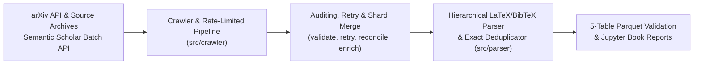

# arXiv Harvester

[](https://www.python.org/downloads/)
[](https://github.com/NguyenQuocDat06-AI/arxiv-harvester/actions/workflows/ci.yml)
[](https://nguyenquocdat06-ai.github.io/arxiv-harvester-book/)
[](https://huggingface.co/datasets/nquocdat06/arxiv-harvester-data)

Scalable, fault-tolerant arXiv multi-version corpus harvester, Semantic Scholar reference collector, and hierarchical LaTeX/BibTeX parser producing deduplicated, schema-validated Parquet datasets.

---

## Overview & Key Results

`arxiv-harvester` implements an end-to-end two-stage data engineering pipeline across 25,000 arXiv publications:

1. **Stage 1 — Multi-Version Acquisition & Citation Harvesting (`src/crawler/`)**: Discovers arXiv publications across assigned ID ranges, reconstructs full version revision histories (`v1..vN`), downloads and extracts LaTeX/BibTeX source archives with HTTP Range resume support, and collects citation graphs via the Semantic Scholar (S2) batch API with local `.bib`/`.bbl` fallback and strict provenance tracking.
2. **Stage 2 — Hierarchical LaTeX/BibTeX Parsing & Deduplication (`src/parser/`)**: Resolves compilation roots and nested TeX includes, builds versioned structural hierarchy trees (sections, paragraphs, lists, math, figures, tables), parses bibliographies (`.bib` and `.bbl`), normalizes citations and content, performs exact-content deduplication, and validates cross-table integrity across all five Parquet output tables.

### Verified Corpus Benchmarks (25,000 Papers — Google Colab CPU-Only)

| Metric | Verified Result | Notes |
|---|---:|---|
| **Publications / Versions** | `25,000` / `41,498` | `38,554` verified TeX, `2,764` PDF-only/empty, `169` HTTP 404 (`0` cross-shard duplicates) |
| **References (Working / Course)** | `976,351` / `456,149` | `0` orphan references; arXiv-keyed rows exported to course spec |
| **Parser Coverage** | `85.66%` success / `97.34%` parsed | `33,025` full success + `4,503` partial on verified TeX; `0` missing versions |
| **Structural Validation** | `structural_valid = True` | `errors = []` across all 5 M1–M2 tables (`arxiv-validate-project`) |
| **Element Deduplication** | `23,099,589 → 15,006,000` (`-35.04%`) | Exact-content deduplication across multi-version documents |
| **BibTeX Deduplication** | `1,834,650 → 1,177,293` (`-35.83%`) | Normalized per-paper citation catalog |
| **Hierarchy Edges** | `22,532,299` | Acyclic, single-root trees verified per `(arxiv_id, version)` |
| **Colab CPU Runtime** | `18,692.09 s` (`0.748 s/paper`) | 5 independent CPU sessions; Peak RSS `845.34 MiB`, weighted avg `240.00 MiB` |
| **Final Output Footprint** | `4.22 GB` (`3.93 GiB`) | Snappy-compressed Parquet tables (`elements`, `hierarchy`, `bibtex`) |

Published analysis and interactive visualizations are available in the **[Jupyter Book Report](https://nguyenquocdat06-ai.github.io/arxiv-harvester-book/)**, and datasets are hosted on **[Hugging Face](https://huggingface.co/datasets/nquocdat06/arxiv-harvester-data)**.

---

## Architecture



---

## Repository Structure

```text
arxiv-harvester/
├── .github/workflows/ci.yml        # Syntax, notebook JSON, package install & CLI smoke CI
├── configs/
│   ├── parser_roots.json           # Verified TeX compilation root overrides
│   └── submission_parser_roots_20261106.json
├── data/                           # Local data placeholders (raw/, shards/, processed/)
├── docs/                           # Analysis notebooks (01–08) for M1 & M2 stages
├── src/
│   ├── crawler/                    # Stage 1: discovery, downloader, S2 scraper, profiler, merge
│   └── parser/                     # Stage 2: TeX gather/lexer, hierarchy, bibtex, dedup, validation
├── tools/                          # Colab/Kaggle runners, 25k consolidator & Jupyter Book builders
├── colab_crawler.ipynb             # Google Colab M1 crawler runner (smoke / repair / full)
├── colab_parser_full.ipynb         # Google Colab M2 full parser runner
├── colab_parser_submission.ipynb   # Google Colab parser snapshot runner
├── kaggle_crawler.ipynb            # Kaggle M1 crawler runner
├── pyproject.toml                  # Package metadata, dependencies & 7 CLI entrypoints
└── requirements.txt                # Direct runtime dependencies
```

---

## Installation

**Prerequisites**: Python `3.10+` and an optional Semantic Scholar API key (`S2_API_KEY`) configured via environment variable or a local `.env` file (never committed).

```bash
git clone https://github.com/NguyenQuocDat06-AI/arxiv-harvester.git
cd arxiv-harvester

python -m venv .venv
source .venv/bin/activate

pip install -r requirements.txt
pip install -e .

# Optional: install Jupyter Book dependencies to build HTML reports
pip install -e ".[report]"
```

Verify the installation:

```bash
python -m compileall -q src tools
arxiv-harvester --help
arxiv-parser --help
```

> **Windows note**: Set `PYTHONUTF8=1` or run `python -X utf8 -m ...` when redirecting console logs to preserve UTF-8 output.

---

## CLI Reference & Usage

Installing the package exposes seven CLI commands (plus module-level utilities under `src/crawler` and `tools/`):

| Command | Entrypoint | Purpose |
|---|---|---|
| `arxiv-harvester` | `crawler.main:main` | Discover IDs, download/extract TeX sources, scrape S2/BibTeX references |
| `arxiv-audit-sources` | `crawler.validate_sources:main` | Audit extracted local sources and emit retry manifests |
| `arxiv-retry-sources` | `crawler.retry_sources:main` | Execute controlled, range-resumable retries from audit manifests |
| `arxiv-reconcile-dates` | `crawler.version_history:main` | Reconcile per-version creation dates via arXivRaw OAI-PMH or snapshots |
| `arxiv-enrich-references` | `crawler.enrich_references:main` | Refresh missing reference metadata while preserving field provenance |
| `arxiv-parser` | `parser.main:main` | Parse TeX/BibTeX revisions into deduplicated hierarchical Parquet tables |
| `arxiv-validate-project` | `parser.validation:main` | Run out-of-core SQLite-backed structural & coverage checks across all 5 tables |

### Stage 1 — Crawling & Reference Collection

Run a full range crawl (example for shard `24120237`), exporting both working tables and the 6-column course tables:

```bash
arxiv-harvester \
  --member-id 24120237 \
  --start-month 2025-02 --start-id 3235 \
  --end-month 2025-02 --end-id 8234 \
  --raw-dir data/raw \
  --output-dir data/shards/24120237 \
  --export-course
```

Common operational flags:

- `--max-papers 5`: Run a smoke test into a dedicated output directory.
- `--dry-run`: Discover metadata only (writes to `_dry_run` without downloading sources or querying S2).
- `--resume` / `--resume --existing-only`: Continue from batch checkpoints or repair missing parts of previously crawled papers without discovering new IDs.
- `--recheck-bib-fallback`: Re-query S2 for rows that previously fell back to local `.bib` parsing.
- `--auto-resume-rate-limit`: Persist checkpoints on HTTP 429, wait through server cooldowns, and resume automatically in-process.

### Auditing, Repair & Shard Consolidation

Network repair utilities default to dry-run planning; pass `--execute` or `--fetch-missing` to perform live requests into a **separate output directory**:

```bash
# 1. Audit local sources and generate a retry manifest
arxiv-audit-sources \
  --publications data/shards \
  --raw-dir data/raw \
  --output data/audits/sources.parquet

# 2. Retry failed or missing revisions safely
arxiv-retry-sources \
  --manifest data/audits/sources.retry.jsonl \
  --output-dir data/repaired_sources \
  --limit 10 \
  --execute

# 3. Reconcile missing revision dates from snapshot or arXivRaw OAI-PMH
arxiv-reconcile-dates \
  --publications data/shards/24120237/publications.parquet \
  --output data/repaired_dates/24120237/publications.parquet \
  --cache-dir data/cache/version_history

# 4. Enrich reference metadata with provenance tracking
arxiv-enrich-references \
  --shard-dir data/shards/24120237 \
  --output-dir data/enriched_references/24120237 \
  --raw-dir data/raw \
  --limit 10 \
  --execute

# 5. Merge member shards and export normalized course tables
python -m crawler.merge_shards --shards-dir data/shards --output-dir data/processed
python -c "from crawler.storage import export_to_course_spec; export_to_course_spec('data/processed', 'data/course_export')"
```

### Stage 2 — Hierarchical Parsing & Validation

Parse all discovered publications and versions into deduplicated Parquet tables, supplying verified compilation root overrides via `--root-overrides` (so ambiguous multi-document archives resolve deterministically without altering raw source files):

```bash
arxiv-parser \
  --publications data/processed/publications.parquet \
  --raw-dir data/raw \
  --output-dir data/parsed \
  --root-overrides configs/parser_roots.json \
  --resume
```

Validate all five M1 + M2 tables against the full publication catalog using streaming batch validation and an on-disk SQLite index:

```bash
arxiv-validate-project \
  --course-dir data/course_export \
  --parsed-dir data/parsed \
  --publications data/processed/publications.parquet \
  --output data/parsed/project_validation.json \
  --require-full
```

(`--require-full` exits `0` on full completion, `1` on structural errors, and `2` when coverage or status is incomplete.)

### Benchmarking & Report Generation

Summarize multi-session runtime and RSS/disk metrics, or build the Jupyter Book HTML report:

```bash
# Aggregate benchmark metrics across multiple run sessions
python -m crawler.benchmark_sessions \
  --stats logs/run1/stats.json logs/run2/stats.json \
  --final-output-dir data/processed \
  --output build/benchmark_sessions.json

# Build the 25,000-paper report from aggregated Colab metrics
python tools/build_team_25000_book.py --output build/m2_book_staging --build

# Or build directly from local M1/M2 tables
python tools/build_report.py --output build/book_source --m1-dir data/processed --m2-dir data/parsed --build
```

---

## Output Layout & Data Schema

### Directory Structure

```text
data/
├── raw/
│   ├── sources/                         # Temporary downloaded archives
│   ├── unzipped/<arxiv_id>/<version>/   # Extracted .tex, .bib, and auxiliary .bbl files
│   └── manifests/<versioned_id>.json    # Per-version source audit & PDF-only/no-LaTeX evidence
├── shards/<member_id>/
│   ├── publications.parquet             # Working M1 publication & per-version metadata
│   ├── references.parquet               # Working M1 citations (S2 + BibTeX fallback)
│   ├── crawl_status.parquet             # Per-paper status, counts & request provenance
│   ├── course_export/
│   │   ├── papers.parquet               # Normalized 6-column M1 papers table
│   │   └── references.parquet           # Normalized 6-column arXiv-keyed references table
│   └── runs/<run_id>/                   # stats.json, paper_metrics.jsonl, resource_samples.jsonl
└── parsed/
    ├── elements/*.parquet               # Deduplicated document structural elements
    ├── hierarchy/*.parquet              # Version-scoped parent-child tree edges
    ├── bibtex/*.parquet                 # Normalized per-paper bibliography entries
    ├── checkpoint.json                  # Input/code/config/output SHA-256 checkpoint
    ├── manifest.json                    # Parse status for every version (including empty/errors)
    └── project_validation.json          # Cross-table validation report
```

### Five-Table Parquet Schema

| Stage | Table | Primary Key / Scope | Core Columns |
|---|---|---|---|
| **M1** | `papers.parquet` | `arxiv_id` | `arxiv_id`, `title`, `authors`, `submission_date`, `revised_dates`, `venue` |
| **M1** | `references.parquet` | `(arxiv_id, ref_arxiv_id)` | `arxiv_id`, `ref_arxiv_id`, `ref_title`, `ref_authors`, `ref_submission_date`, `ref_s2_id` |
| **M2** | `elements/*.parquet` | `element_id` | `element_id`, `arxiv_id`, `kind` (dict), `content` |
| **M2** | `hierarchy/*.parquet` | `(arxiv_id, version, element_id, parent_id)` | `arxiv_id`, `version`, `element_id`, `parent_id` |
| **M2** | `bibtex/*.parquet` | `(arxiv_id, citation_key)` | `arxiv_id`, `citation_key`, `entry_type` (dict), `title`, `authors`, `year`, `doi`, `journal`, `url` |

---

## Cloud Execution (Google Colab & Kaggle)

The repository includes self-contained notebooks and orchestrators designed for ephemeral CPU runtimes:

- **`colab_crawler.ipynb`**: Supports `smoke` (5-paper verification), `repair` (missing sources/references), and `full` modes. Stages raw/shard I/O on fast local `/content` SSD (`USE_LOCAL_WORKSPACE=True`), runs incremental Drive backups with SHA-256 verified `HEAD.json` archive chains, and stops cleanly before disk exhaustion (`2 GiB` floor).
- **`colab_parser_full.ipynb` & `tools/m2_colab_runner.py`**: Verifies M1 archive chains, runs cold 5,000-paper/member CPU parsing, validates outputs, and syncs parsed batches, `m1_tables/`, and `resource_samples.jsonl` back to Google Drive.
- **`tools/m2_team_consolidator.py`**: Merges all 5 member shards, checks cross-shard `.parquet` uniqueness, runs full 5-table `src.parser.validation`, and summarizes multi-session CPU/RSS benchmarks via `src.crawler.benchmark_sessions`.
- **`kaggle_crawler.ipynb`**: Alternative Kaggle runtime crawler.

---

## Engineering Highlights

- **Provider-Isolated Rate Limiting & Cooldown Persistence**: Enforces arXiv politeness pacing (`>=3.0 s` between metadata/source requests on a single connection) independently from Semantic Scholar batching (`--s2-batch-size 50`, `5 s` pacing). Cooldown deadlines persist across restarts in `--rate-state-dir` with OS-level local file locks and full `Retry-After` compliance.
- **Fault-Tolerant Resumption & Range Downloads**: Supports HTTP `Content-Range` `.part` resumption with adaptive chunk sizing, per-paper bounded background queues (`--max-inflight-papers 25`), atomic `.tmp` Parquet swaps, and `--min-free-gb` disk guards.
- **Strict Provenance & Zero-Fabrication Guarantees**: Distinguishes `not_indexed`, `api_error`, `bib_fallback`, `no_latex` (verified HTML with matching DOI), and `.bbl` auxiliary bibliographies. Missing submission dates and broken TeX archives are never fabricated into synthetic successes.
- **Memory-Bounded Out-of-Core Validation**: `arxiv-validate-project` streams Parquet shards in batches backed by an on-disk SQLite index, validating one `(arxiv_id, version)` tree at a time so full 25,000-paper validation completes safely within 12 GiB Colab RAM.

---

## Team & Contributors

| Member | Student ID | GitHub | Assigned arXiv ID Range | Core Ownership |
|---|---|---|---|---|
| Nguyễn Quốc Đạt | `24120282` | [@NguyenQuocDat06-AI](https://github.com/NguyenQuocDat06-AI) | `2412.18848` → `2501.02641` | Discovery, version history, request policy & integration |
| Nguyễn Đình Tuấn | `24120237` | [@tuan0306](https://github.com/tuan0306) | `2502.03235` → `2502.08234` | Source downloader, range-resumable retry, source audit & backup |
| Trần Nguyên Tân | `24120438` | [@nguyentan10052006-cmyk](https://github.com/nguyentan10052006-cmyk) | `2407.12839` → `2407.17838` | Semantic Scholar batching, reference retry, enrichment & provenance |
| Dương Phan Minh Trí | `24120470` | [@takryudor](https://github.com/takryudor) | `2406.17938` → `2407.02838` | Storage schema, shard merging, LaTeX/BibTeX parser & 5-table validation |
| Trịnh Vỹ Triết | `24120474` | [@AIVIETNAM-AIO-Triet-Descartes](https://github.com/AIVIETNAM-AIO-Triet-Descartes) | `2406.12938` → `2406.17937` | CLI runner, Colab/Kaggle orchestration, resource profiling & Jupyter Book reports |
